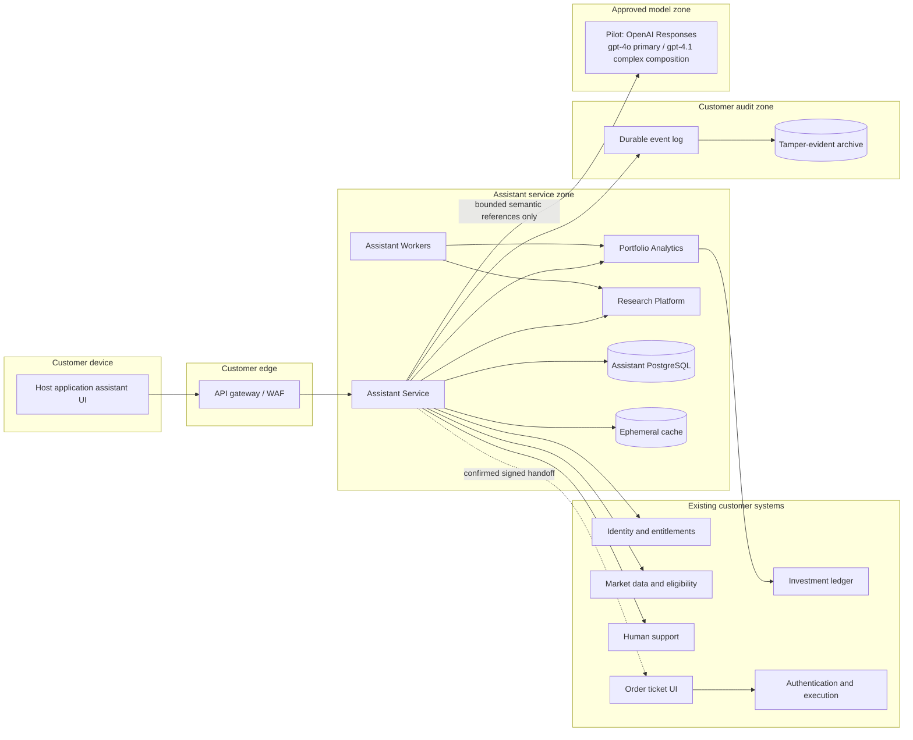
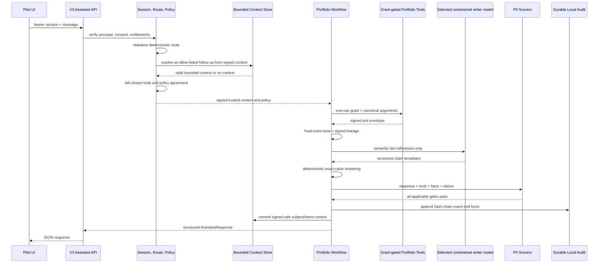

# Governed Investment Assistant — V3 Architecture and Production Target

Status: V3 implemented for an internal pilot; customer-production architecture remains proposed

Scope: portfolio insight, public research, governed product knowledge, and non-executing order-ticket handoff

Source: implemented contracts, architecture decisions, and production-readiness
controls in this repository

## Current Assistant V3 implementation (July 2026)

V3 is a side-by-side, ground-up Mastra runtime under `src/assistant-v3`. “V3” is this repository's architecture revision, not a Mastra major version. The validated lockfile resolves `@mastra/core` to `1.57.0` and the private Studio CLI to `1.23.0`.

The internal pilot uses synthetic client identity and ledger data, including holdings, lots, transactions, cash flows, income, fees, and corporate actions. Its zero-configuration market adapter is also synthetic and entirely offline, so starting a public clone does not contact an external market-data endpoint. Developers may explicitly select the Yahoo development adapter with `ASSISTANT_DEMO_MARKET_PROVIDER=yahoo-development` only after validating their own access and usage rights; that adapter remains impossible in staging or production. Missing provider or ledger evidence remains unavailable and is never filled from model memory.

The registry is exact and drift-checked:

- three no-tool writers—`public-research-writer`, `portfolio-insight-writer`,
  and `approved-knowledge-writer`—plus the tool-less
  `financial-task-planner`;
- five workflows: `assistant-request-v3`, `public-research-v3`, `portfolio-insight-v3`, `approved-knowledge-v3`, and `order-ticket-handoff-v3`; and
- thirteen grant-gated boundary tools: `resolve-instrument`,
  `read-market-snapshot`, `read-price-history`,
  `read-instrument-research`, `read-market-content`, `convert-currency`,
  `analyze-portfolio-allocation`, `read-portfolio-snapshot`,
  `read-portfolio-activity`, `retrieve-reviewed-investment-education`,
  `retrieve-approved-product-knowledge`, `read-order-eligibility`, and
  `create-signed-order-handoff`.

All writers use the OpenAI Responses API with `gpt-4o` as the primary model and `gpt-4.1` only for deterministically classified complex composition. The pre-generation selector escalates comparisons, multi-facet evidence, multi-citation knowledge, and evidence-heavy explanations; provider errors never cause escalation and the writer cannot select its own tier. Both tiers use temperature `0`, a 256-token ceiling, `store: false`, no fallback model, and structured claim templates. Writers have no tools, URLs, SQL, account identifiers, arithmetic authority, or customer-workflow transcript memory. Private loopback Studio agents may use isolated last-ten-message thread memory for developer testing; customer workflow registries remain stateless. Workflows own branching and tool execution. Deterministic services calculate financial, fee, technical, risk, and sentiment facts; authoritative money uses fixed-point decimal arithmetic, and a deterministic renderer inserts exact numbers and dates after inference.

Conversation continuity is implemented outside the writers as bounded deterministic control-plane state. Only a signed, allow-listed public instrument subject and safe intent may be retained after response gates pass and the durable audit append succeeds. The pilot context is bound to tenant, principal, session, and conversation and expires after five minutes or three follow-up hops; the process store is capped at 10,000 entries. It contains no prompt or response text, facts, prices, balances, account/order data, citations, or free-form user profile. Missing, expired, corrupt, wrong-scope, or unavailable context produces stateless routing or clarification rather than model recall.

The authoritative lifecycle is:

```text
server-issued session → tenant/consent/entitlement check → safety-first route
→ bounded semantic plan for still-unmatched safe financial turns
→ trusted route compiler → fail-closed policy
→ workflow-owned one-use tool grants → signed evidence/facts
→ constrained writer → deterministic rendering → eight blocking P0 scorers
→ durable audit append → bounded conversation-context commit → response
```

The internal-pilot contract is `POST /v1/assistant/sessions`, `POST /v1/assistant/messages`, `POST /v1/assistant/order-handoffs/{intentId}/confirm`, and the authenticated pilot-only `POST /v1/assistant/order-handoffs/open`; `/api/chat` is temporary compatibility only. Requests cannot choose client/account IDs, conversation IDs, policy filters, tool arguments, or arbitrary provider operations.

Order handoff is implemented for the internal pilot as preview → explicit confirmation → five-minute, one-use, principal-bound signed reference → one-time verification into a sanitized `/orders/preview` state. It uses Mastra suspend/resume and never submits, changes, or cancels an order. The pilot review page disables submission and marks price, fees, balance, disclosures, eligibility, authentication, and final confirmation as pending; it is not the destination OMS/order screen.

Mastra workflow runs persist in separate local LibSQL files for the application and private Studio. A local append-only JSONL audit outbox uses a SHA-256 chain and flushes every event before delivery. Session authority, bounded conversation context, and suspended handoff state are still process-local. Private Studio is bound to loopback and uses only public-development, approved-document, or fixed-synthetic diagnostic adapters; it is not a customer-data surface. The application production build excludes the Studio entry point, Studio-only modules, and Editor overrides, and the container prunes Studio CLI, Editor, and Studio-memory development dependencies.

The pilot has a multi-stage non-root container, a hardened loopback-only Compose profile, and CI for type checking, tests, production build, dependency audit, dependency SBOM, and container provenance/SBOM. That baseline is not customer-production acceptance evidence.

This document distinguishes that implemented pilot from the production target below. Mock/unauthenticated identity, synthetic ledger data, synthetic or development-only market data, development symmetric signing, local storage and audit, process-local authority/conversation/handoff state, unauthenticated legacy routes, unresolved OpenAI governance, or Studio in the customer artifact are automatic customer-production blockers. Integration with the deploying institution's identity and entitlement systems, licensed feeds, managed purpose-bound asymmetric signing, approved HA state, a transactional outbox and independently tamper-evident audit archive, controlled AZ/EN evidence approvals, consent/DLP, real OMS integration, browser/accessibility and performance evidence, penetration/recovery exercises, SLO operations, and regulatory sign-off remain required.

## 1. Executive decision

Build the production control plane as a **modular assistant service**, not as a collection of independently deployed microservices. Keep deterministic portfolio calculations, market data, document ingestion, audit storage, and the deploying institution's existing trading capabilities behind narrow internal interfaces.

This produces six deployment units:

1. **Assistant Service** — authenticated API, consent, policy, orchestration, retrieval coordination, response composition, and the provider-neutral model gateway.
2. **Portfolio Analytics Service** — read-only calculations over the institution's authoritative ledger data. It is the only new assistant component allowed to read portfolio positions and transactions.
3. **Research Platform** — approved-document ingestion, indexing, retrieval, and citation metadata.
4. **Market and Instrument Facade** — a normalized interface over licensed U.S. and Azerbaijani market data and the institution's product eligibility service. This may be an existing platform capability.
5. **Assistant Workers** — document ingestion, re-indexing, proactive insight generation, evaluation runs, and retention jobs.
6. **Audit Pipeline** — append-only events delivered to institution-controlled tamper-evident storage.

Order placement, cancellation, transfers, withdrawals, suitability decisions, and investment recommendations are outside the assistant trust boundary.

## 2. Goals and non-goals

### Goals

- Answer authenticated support, instrument, and portfolio questions in Azerbaijani and English.
- Make every financial amount, date, and eligibility result traceable to a deterministic internal service.
- Ground informational answers in approved and versioned sources.
- Enforce consent, authorization, data-loss-prevention, and advice policies before and after model inference.
- Continue operating safely when a model, market feed, index, or portfolio dependency is unavailable or stale.
- Support a separately gated order-ticket preview and signed handoff without giving the assistant execution authority.
- Give Risk, Legal, Security, and Operations enough evidence to reconstruct every material response.

### Non-goals

- Personalized investment advice or suitability assessment.
- Portfolio optimization, target allocation, or “best for you” comparisons.
- Autonomous order submission, modification, or cancellation.
- Open-web browsing by the production assistant.
- Using the LLM to calculate authoritative performance, P&L, prices, fees, or balances.
- Replacing the deploying institution's ledger, order-management, identity, entitlement, support, or market-data systems.

## 3. Architecture principles

1. **Deterministic facts, generated explanation.** Internal services calculate facts; the model explains them.
2. **Fail closed at trust boundaries.** Missing consent, authorization, DLP proof, policy proof, audit durability, or data freshness blocks the affected capability.
3. **Least privilege by tool.** Each tool has its own identity, data scope, timeout, and sensitivity classification.
4. **No execution path.** The assistant runtime has no network route, credential, SDK, or tool capable of submitting an order.
5. **Approved evidence only.** Retrieval is restricted to approved, effective, unexpired content and licensed data.
6. **Provider portability.** The deploying organization owns prompts, evaluations, tool contracts, audit records, and retrieval; managed LLMs are replaceable inference dependencies.
7. **Progressive exposure.** Public support, research, portfolio insight, proactive insight, and ticket handoff are separate feature-flagged capabilities.
8. **Locale is part of correctness.** Azerbaijani and English content, policy tests, citations, and fallbacks are versioned independently.

## 4. System context and trust boundaries



The pilot calls OpenAI as an external inference provider and sends bounded semantic references rather than account identifiers or raw ledger rows. Its egress boundary is therefore the most restrictive boundary: only the model adapter may cross it, and the provider cannot initiate connections into the customer environment, call tools directly, or receive reusable customer or execution credentials. Customer production remains blocked until the deploying organization approves procurement, residency, DLP, egress, model-risk, quota, and credential controls.

## 5. Deployment and module design

### 5.1 Assistant Service

Use a modular monolith with enforced package/module boundaries. Modules communicate through in-process interfaces and typed domain objects, not direct access to each other's tables.

| Module | Responsibility | Must not do |
|---|---|---|
| API and streaming | Mobile-facing REST endpoints, request validation, idempotency, SSE, locale negotiation | Business policy or financial calculation |
| Session | Session lifecycle, capability snapshot, and signed bounded subject/intent context | Store raw credentials, prompts, responses, portfolio facts, account/order data, citations, or model profiles in cache |
| Consent | Versioned consent records and revocation checks | Infer consent from general app terms |
| Policy | Intent/risk classification, capability authorization, pre/post-inference rules | Delegate final enforcement to the LLM |
| Orchestrator | Select an approved workflow and invoke allow-listed tools | Construct arbitrary tools or call execution systems |
| Retrieval coordinator | Query approved indexes and enforce evidence metadata filters | Browse the open web |
| Model Gateway | DLP, masking, model routing, prompt registry, budgets, provider failover | Receive unmasked exact balances or account identifiers |
| Response composer | Merge generated narrative with signed facts, citations, notices, and actions | Let generated text override signed facts |
| Escalation | Create a support handoff with approved transcript summary | Send portfolio data not required by support workflow |
| Audit publisher | Persist pre-inference and outcome audit envelopes | Put raw PII in general application logs |

Start with one codebase and one production deployment for these modules. Extract a module only when independent scaling, security isolation, ownership, or release cadence is demonstrated in production. Policy, consent, and audit publication should remain together unless there is a strong governance reason to separate them.

### 5.2 Portfolio Analytics Service

This service has read-only access to an authoritative ledger interface or governed read model. It returns versioned, signed results and never returns more history than the requested calculation requires.

Responsibilities:

- Realized and unrealized P&L.
- Time-bounded earnings and performance using an independently reviewed methodology approved by the deploying institution.
- Allocation and exposure by asset class, instrument, market, currency, sector, issuer, rating, and maturity.
- Holding-level movement attribution and upcoming portfolio events.
- Bond maturity ladder, coupon schedule, yield inputs, duration, and rating exposure.
- Explicit `asOf`, source timestamps, calculation version, data-quality flags, and missing-data reasons.

Implementation rules:

- Use decimal arithmetic, ISO 4217 currencies, UTC instants, and explicit customer display time zone.
- Make every calculation reproducible from a calculation version and input snapshot identifier.
- Sign authoritative result envelopes; the Assistant Service verifies the signature before rendering.
- Reconcile daily against ledger/accounting reports and alert on variance.
- Cache only non-sensitive derived data under short, policy-approved TTLs and customer-scoped keys.

### 5.3 Research Platform

The platform separates ingestion from serving:

- **Ingestion:** acquire, malware-scan, parse, normalize, classify, approve, chunk, embed, and index documents.
- **Serving:** apply locale, product, jurisdiction, approval, effective-date, and expiry filters before semantic and lexical retrieval.
- **Evidence registry:** retain the immutable source version, checksum, owner, approval, effective period, and canonical document reference.

Retrieval should be hybrid lexical/vector search with a reranker that is evaluated separately by locale. A retrieved passage is unusable unless its metadata passes all policy filters.

Required evidence metadata:

```text
sourceId, sourceVersion, title, canonicalReference, locale,
jurisdiction, productScope, owner, approvalStatus,
effectiveFrom, expiresAt, checksum, indexedAt
```

### 5.4 Market and Instrument Facade

Normalize the deploying institution's licensed feeds and product catalog behind two contracts:

- `get_market_snapshot(instrumentId)` returns price, currency, venue, market state, timestamp, delayed/live status, and corporate-action flags.
- `get_instrument_eligibility(customerContext, instrumentId)` returns whether the instrument is researchable/orderable, supported sides and order types, limits, fractional support, and required disclosures.

Researchability and orderability are distinct. A stale or unsupported eligibility response prevents ticket handoff but need not prevent a clearly timestamped educational answer.

### 5.5 Assistant Workers

Workers run outside the request path and use separate service identities:

- Approved-content ingestion and expiry processing.
- Index rebuilds and embedding migrations.
- Offline evaluation and regression suites.
- Precomputed portfolio insight candidates.
- Retention, deletion, and legal-hold workflows.
- Audit archive verification.

Proactive insights are candidates, not customer notifications. A policy check runs again at delivery time using current consent, eligibility, and freshness.

### 5.6 Order Ticket Handoff Boundary

The V3 internal pilot implements the assistant side of this boundary, but customer deployment still requires integration with the institution's real order screen and separate approval. It records a short-lived, user-initiated preview and produces a signed reference only after an explicit confirmation call. The pilot consumes that reference into a sanitized, non-executable internal review page; it does not prefill an existing order ticket.

It may:

- Validate instrument identifiers and the requested side, amount/quantity, and order-type preference.
- Ask the authoritative eligibility service whether ticket handoff is currently permitted.
- Generate an expiring, single-use reference that a future host order screen can verify and consume.
- Bind the reference to the authenticated principal and consume the confirmation token once.

It may not:

- Validate final price, fees, balance, suitability, or execution eligibility on behalf of the order system.
- Submit, amend, cancel, or schedule an order.
- Carry an authentication decision from chat into order execution.

A customer order screen must re-fetch all material facts and require review, authentication, and fresh explicit confirmation. The current pilot review page displays those checks as pending and keeps submission disabled. Pilot eligibility and handoff adapters are synthetic; they are not an OMS integration.

### 5.7 Deployment topology

Run production assistant workloads and all customer-owned stores in infrastructure controlled by the deploying organization and located in the approved region, distributed across at least two failure domains. Keep the API gateway/WAF in front of private application subnets and permit outbound model traffic only through a controlled egress proxy used by the Model Gateway.

- Isolate development, test, staging, and production with separate identities, keys, networks, stores, and provider projects.
- Use only synthetic customer data in development. Any production-derived test fixture must pass an approved irreversible anonymization process.
- Deploy the Assistant Service and Portfolio Analytics independently so portfolio access can use a more restrictive network and workload policy.
- Keep PostgreSQL, the audit log, object storage, search indexes, secrets, and telemetry endpoints private; none are reachable from the public internet or model provider.
- Use multi-zone managed data services or deployment-platform equivalents with encrypted backups and tested point-in-time recovery.
- Manage capability, model, prompt, locale, knowledge-source, and instrument-family rollout through centrally audited feature flags.
- Define production capacity from measured canary demand and load-test at the expected peak plus the resilience margin required by the deploying organization's platform standard.

## 6. Core API contracts

### 6.1 Mobile API

#### `POST /v1/assistant/sessions`

Creates a server-owned pilot session. The pilot synthesizes the trusted principal, tenant, consent, and entitlement snapshot behind this boundary; customer production must derive them from the deploying institution's identity and policy services.

Request:

```json
{
  "locale": "az-AZ"
}
```

Response includes a bearer `sessionToken`, server-owned `sessionId` and `conversationId`, locale, consent state, enabled capabilities, and expiry. Capability state is a display snapshot; every message is re-authorized server-side. Customer-supplied subject, account, tenant, policy, tool, or conversation identifiers are rejected.

#### `POST /v1/assistant/messages`

Requires `Authorization: Bearer <sessionToken>` and accepts only:

```json
{
  "message": "Portfelimin cari dəyəri nə qədərdir?"
}
```

The current pilot returns one structured `AssistantResponse` JSON document containing conversational text, typed facts, charts, citations, actions, notices, freshness, provenance, and scorer summary. Future mobile streaming may transport the same typed parts as events; it must not parse facts or actions from model prose.

#### `POST /v1/assistant/order-handoffs/{intentId}/confirm`

Requires the same session bearer token and a principal-bound suspended preview. The only accepted body is:

```json
{
  "confirmed": true
}
```

On success it consumes the confirmation state and returns a five-minute, one-use signed handoff reference. It never creates or submits an order. An expired, reused, wrong-principal, or mismatched intent fails closed.

#### `POST /v1/assistant/order-handoffs/open`

This authenticated internal-pilot endpoint consumes the signed handoff once after verifying its signature, purpose, signed payload, expiry, principal, tenant, session, and conversation binding. It returns only a sanitized `OrderHandoffScreenState` for `/orders/preview`; the compact reference is not placed in a URL or browser storage. The review state has `submissionAllowed: false` and marks every authoritative OMS check as pending. This endpoint demonstrates the trust-boundary handoff and is not a customer trading API.

`POST /api/chat` is a temporary compatibility adapter. It accepts only `message` and optional `locale`, creates its own V3 session, and returns the same structured response. It must be removed after the frontend and API consumers complete migration.

If a later transport uses SSE, the allowed typed event families are:

```text
ack
notice
text_delta
fact
citation
navigation_action
order_handoff_preview
escalation
done
error
```

`fact`, `citation`, and action events remain structured server output. They are never parsed back out of model prose.

### 6.2 Internal tool envelope

Every tool request carries:

```text
requestId, sessionId, customerSubjectRef, locale,
purpose, capability, authorizationContext, requestedAt
```

Every result carries:

```text
schemaVersion, resultId, asOf, freshness, dataQuality,
payload, sourceRefs, producer, producerVersion, signature
```

Tool calls are defined in code and registered with scope, sensitivity class, maximum result size, timeout, retry policy, and fallback behavior. In V3, the deterministic route and workflow choose the reviewed tool and canonical arguments; writer agents have no tools and cannot propose or alter a capability call.

### 6.3 Primary domain contracts

- `PortfolioInsight` — period, methodology, performance, allocation, drivers/detractors, exposures, events, timestamps, and data-quality flags.
- `Evidence` — immutable source/version, passage reference, effective date, market timestamp where relevant, and coverage status.
- `InstrumentEligibility` — separate research/order flags, supported operations, market state, limits, and disclosures.
- `NavigationAction` — allow-listed host-application destination plus non-sensitive parameters.
- `OrderIntent` — instrument, side, amount or quantity, requested order type, expiry, and deep-link reference; no submit operation.
- `PolicyDecision` — policy version, classified intent, sensitivity, permitted capability, obligations, deny/escalate reason, and evaluation timestamp.

Version external and internal schemas explicitly. Additive changes are preferred; breaking versions run side by side during mobile migration.

## 7. Authoritative response flow

### 7.1 Portfolio question



The exact financial values displayed to the customer come from verified signed facts and are inserted by the response composer after inference. Writer output cannot supply a number or date. If lineage, rendering, or any P0 scorer fails, delivery is blocked and the affected capability is disabled until restart. The bounded context update occurs only after the audit append succeeds; a context read failure behaves as no memory, and a context write failure cannot turn an unaudited response into a delivered one.

### 7.2 Approved research question

1. Classify the request deterministically and distinguish public instrument research from governed product knowledge.
2. For governed product knowledge, derive exact locale, jurisdiction, channel, product, approval, lifecycle, and effective-date filters from trusted server context.
3. Retrieve and rerank only eligible immutable passages; the request cannot supply vector filters.
4. Measure coverage and conflicts; do not generate a factual answer when required evidence is absent or ineligible.
5. Give the constrained writer only bounded semantic fact/citation references.
6. Verify claim lineage, citation integrity, exact values/dates, policy, and conversational quality independently.
7. Commit the audit event, then return narrative, citations, timestamps, and limitations as separate response parts.

### 7.3 Order-ticket handoff

1. Confirm the request is user initiated; never create an intent from a proactive suggestion.
2. Resolve the instrument, normalize the requested side and notional, and check current handoff eligibility.
3. Return a neutral preview card; do not create a handoff from chat text alone.
4. Suspend the workflow and issue principal-bound confirmation state.
5. Require an explicit `POST /v1/assistant/order-handoffs/{intentId}/confirm` with the same session.
6. Consume the confirmation once and create an expiring signed opaque handoff reference.
7. The order system independently re-fetches price, fees, balance, disclosures, and eligibility.
8. The customer reviews, authenticates, and confirms inside the existing execution boundary.

## 8. Data architecture

### 8.1 Stores

| Store | Data | Notes |
|---|---|---|
| Assistant PostgreSQL | Sessions, consent versions, capability snapshots, conversation metadata, prompt/policy versions, escalation and order-intent references | Encrypt fields; avoid copying ledger data |
| Transcript store | Retention-classified messages and response parts | Separate encryption keys and access policy from operational DB |
| Ephemeral cache | Rate limits, idempotency results, and signed short-lived subject/intent context | No durable source of truth; tenant/principal/session/conversation-scoped keys, enforced TTL/hop/capacity bounds, and no transcript or financial facts |
| Research object store | Approved source binaries and normalized text | Immutable versions, malware scanning, checksum verification |
| Search index | Approved chunks, embeddings, metadata | Rebuildable from the evidence registry |
| Durable audit log/archive | Append-only policy, tool, model, response, consent, and handoff events | Tamper evidence, legal hold, restricted replay access |
| Analytics read model | Governed portfolio inputs if direct ledger calls are unsuitable | Reconciled, versioned, read-only to assistant components |

### 8.2 Data minimization

Use an opaque `customerSubjectRef` inside assistant systems. Do not send names, CIFs, account numbers, contact details, transaction IDs, exact balances, or raw transaction descriptions to the model provider. Replace instruments held by the customer with session-scoped aliases when the public symbol is not required for the answer.

Conversation memory is a deterministic routing aid, not a transcript or source of financial truth. Persist only the minimum signed public subject and allow-listed intent after the response has passed its P0 gates and the audit append has committed. Never use remembered state to restore authorization, consent, order confirmation, facts, values, citations, or a sensitive/boundary route. Treat a failed read, invalid signature, scope mismatch, TTL/hop exhaustion, or store outage as no context.

The audit archive may contain sensitive internal inputs required for reconstruction, but stores them under customer-controlled encryption and access policies. General logs and metrics contain only identifiers safe for operations.

### 8.3 Consistency and audit durability

- Store consent and policy decisions transactionally before privileged processing.
- Persist a pre-inference audit event durably before external inference.
- Persist the final response event before marking the stream complete.
- Use an outbox to deliver audit events from the Assistant Service to the archive without dual-write loss.
- Use idempotency keys for message creation, escalation, proactive insight delivery, and order-intent creation.
- Update bounded conversation context only after the final audit event commits; memory-write failure must not rewrite or weaken the delivered audited response.
- Preserve append-only corrections: never overwrite an earlier audit event.
- For a submitted order reached through a signed assistant handoff, retain the handoff provenance and associated assistant evidence for the period required by the deploying institution's approved retention policy, aligned with the authoritative order record.

## 9. Security and policy architecture

### Identity and authorization

- Reuse the host application's identity, session assurance, device risk, and entitlements.
- Validate the authenticated customer subject at the edge and again at privileged internal services.
- Use workload identity and mutual TLS for service-to-service calls.
- Apply customer, account, purpose, capability, locale, and jurisdiction attributes to authorization.
- Do not propagate mobile access tokens to the model provider or background workers.

### Model egress

- Route all inference through a network allow-listed gateway.
- Enforce zero retention/no training contract configuration and verify it continuously where the provider exposes controls.
- Run DLP after prompt construction, not only on the original user message.
- Reject calls when consent, provider policy, masking, tenant routing, or audit persistence cannot be proven.
- Apply per-capability model allow-lists, token budgets, timeout limits, circuit breakers, and kill switches.
- Permit provider failover only to providers already approved for the same data classification and region policy.

### Prompt and retrieval security

- Treat user text, tool results, and retrieved documents as untrusted data, never as system instructions.
- Delimit content and keep policy/tool definitions outside retrieved context.
- Scan indexed documents for prompt-injection patterns and quarantine suspicious content for human review.
- Keep writer agents tool-free. Authorize reviewed workflow arguments before every tool call; generated text can never confer permission.
- Test cross-customer isolation, indirect prompt injection, data exfiltration, encoding tricks, and multilingual policy bypasses.

### Secrets and keys

- Store provider keys, signing keys, and database credentials in the deploying organization's managed secrets system.
- Use separate keys and identities by environment and service.
- Rotate model-provider credentials without deploying application code.
- Keep portfolio-result signing keys inaccessible to the Assistant Service; it receives verification keys only.

## 10. Reliability and degradation

Initial targets, to be finalized against the deploying organization's platform SLOs:

| Measure | Proposed target |
|---|---:|
| Assistant API availability | 99.9% monthly |
| Completed deterministic response | p95 at or under 3 seconds |
| Completed generated research/RAG response | p95 at or under 12 seconds |
| Authorization and policy checks | p95 under 300 ms combined |
| Audit event loss | 0 acknowledged material events |
| Exact financial facts from signed tools | 100% |

Degradation behavior:

| Failure | Behavior |
|---|---|
| Model unavailable | Return structured facts/citations where safe or offer retry/escalation; never invent a fallback answer |
| Portfolio Analytics unavailable | Do not answer portfolio-value/performance questions; public support remains available |
| Market data stale | Show the timestamp and stale/delayed state; block flows requiring current eligibility or price |
| Research index unavailable | Answer only from deterministic public facts explicitly designed for that fallback; otherwise escalate |
| Audit durability unavailable | Block portfolio/model processing; optionally serve pre-approved static support content with a minimal local event |
| DLP or consent service unavailable | Do not call the external model |
| One locale has insufficient approved evidence | Say so in that locale and offer human support; do not silently use unapproved translation |

Use bounded retries with jitter only for idempotent internal reads. Apply deadlines from the incoming request, circuit breakers per dependency, bulkheads for expensive portfolio/model work, and backpressure on SSE connections.

## 11. Observability and operations

Use a correlation ID across the mobile request, policy decisions, tool calls, model call, citations, response parts, and audit events.

Operational telemetry:

- Request rate, latency, errors, timeouts, retries, and circuit-breaker state by capability.
- Consent/DLP/policy deny rates without raw customer content.
- Retrieval coverage, citation entailment, source expiry, index age, and no-answer rate.
- Model latency, token use, fallback, regeneration, and cost by prompt/model version.
- Portfolio input freshness, calculation version, reconciliation variance, and signature failures.
- Escalation rate, customer feedback, ticket-handoff completion, and downstream validation failure.
- Security events for cross-account attempts, injection detections, abnormal tool patterns, and audit gaps.

Traces and logs must be redacted at source. Access to transcript and audit-replay tools is privileged, justified, time-bound, and itself audited.

Runbooks and independent kill switches are required for:

- All external inference.
- Portfolio tools.
- Each research source or instrument family.
- Proactive insights.
- Each order-intent instrument family.
- A specific model, prompt version, or locale.

## 12. Testing and release gates

### Test layers

1. **Unit and property tests** — policy rules, decimal calculations, locale formatting, masking, and response composition.
2. **Contract tests** — ledger, market, eligibility, support, mobile SSE, and model-provider adapters.
3. **Golden evaluations** — approved AZ/EN support, research, portfolio, refusal, stale-data, and ambiguity cases.
4. **Adversarial evaluations** — advice elicitation, guaranteed returns, prompt injection, data extraction, cross-account access, and Unicode/translation attacks.
5. **Reconciliation tests** — portfolio outputs against authoritative statements and independently calculated fixtures.
6. **Resilience tests** — provider timeout, partial SSE disconnect, stale feeds, audit outage, index rollback, and duplicate requests.
7. **Penetration and privacy tests** — egress, secrets, tenant isolation, log leakage, and transcript access.
8. **Canary evaluation** — sampled production outputs scored without using unapproved data or automated customer-impacting actions.

### V3 acceptance gates

These are promotion requirements, not a statement that customer-production validation is complete. The repository currently lacks retained browser E2E/accessibility, load/soak/SLO, penetration, disaster-recovery, live governed-provider, and external customer-system integration evidence. Unit/integration tests, a local browser check, Studio traces, or a successful container build cannot substitute for those artifacts.

- All eight MVP prompt families pass separately in `az-AZ` and `en-US`, including typo, morphology, code-switching, and multi-turn variants.
- Route accuracy is at least 98% independently for each locale.
- Tool arguments, result hashes, fact derivations, numeric replay, and material claim lineage pass 100%.
- There is zero cross-tenant disclosure, consent bypass, invalid-signature acceptance, mutation capability, ungrounded number, uncited material claim, telemetry PII, or audit bypass.
- Bounded context passes AZ/EN subject/intent carryover, explicit-override, tenant/principal/session isolation, TTL/eviction, hop-limit, tamper, outage, and sensitive-data non-retention tests; writer agents remain transcript-memory-free.
- RAG Recall@5 is at least 0.90, MRR at least 0.90, and nDCG@5 at least 0.85 per locale/facet; revoked, expired, conflicting, or wrong-locale evidence produces no factual answer.
- No model-accessible order, transfer, withdrawal, credential, URL, SQL, HTTP-method, or arbitrary vector-filter capability exists.
- Property tests cover fractional quantities, fees, rounding, zero/negative values, corporate actions, and cash-flow timing.
- Failure injection covers OpenAI, market, portfolio, RAG, policy, signer, storage, and audit dependencies.
- Browser E2E covers portfolio responses, research cards, citations, charts, handoff preview/confirmation, and accessibility.
- `npm run check`, the production build, API contracts, and a governed OpenAI readiness probe pass.
- Rollback and kill-switch drills succeed before a capability expands beyond an approved pilot cohort.

These thresholds are necessary but not sufficient: severity-weighted failures, complaints, or any execution-boundary breach stop rollout regardless of aggregate score.

## 13. Delivery plan

### Phase 0 — Decisions and platform readiness

- Confirm the deploying organization's supported backend language/runtime, Kubernetes/platform standards, identity protocol, event bus, secrets, and observability stack.
- Agree data classification, residency, consent wording/versioning, transcript retention, and audit retention.
- Approve performance/P&L methodology and market-data licensing.
- Define ADRs, schemas, service identities, and threat model.

Exit: Security, Legal, Risk, Architecture, Mobile, and Investment Operations sign off the trust boundaries and non-goals.

### Phase 1 — Safe assistant foundation

- Implement Assistant Service skeleton, session API, SSE, consent, policy, audit outbox, provider-neutral Model Gateway, DLP, feature flags, and kill switches.
- Use synthetic data only.
- Establish CI, contract tests, prompt registry, offline evaluation harness, and redacted telemetry.

Exit: support-only messages can traverse the complete audited path in a non-production environment.

### Phase 2 — Approved support and navigation

- Build the research ingestion/approval workflow and bilingual retrieval.
- Add tariffs, FAQs, disclosures, onboarding and identity-verification guidance, funding, withdrawals, market hours, order types, and allow-listed navigation actions.
- Integrate human escalation.

Exit: employee pilot meets support accuracy, citation, refusal, latency, and security gates.

### Phase 3 — Public market and instrument research

- Integrate instrument resolution, market snapshots, prospectuses, approved research, corporate actions, and dynamic researchability.
- Add stale/delayed market notices and ambiguous-symbol handling.

Exit: small customer canary passes bilingual grounding and market-freshness gates.

### Phase 4 — Portfolio Insights

- Implement and reconcile Portfolio Analytics.
- Add signed tool results, aggregate masking, response composition, performance methodology notices, and portfolio-specific evaluation sets.
- Run a staff dogfood and limited customer cohort before wider rollout.

Exit: calculation reconciliation, privacy, access isolation, advice blocking, audit reconstruction, and operational readiness are signed off.

### Phase 5 — Proactive informational insights

- Generate candidates for maturity, earnings, concentration, and unusual movement events.
- Re-check policy, consent, freshness, and eligibility at delivery time.
- Add frequency controls and customer opt-out.

Exit: notification usefulness and complaint guardrails are met in a limited cohort.

### Phase 6 — Controlled order-ticket handoff

- Conduct a separate threat model and regulatory approval.
- Replace the pilot eligibility/handoff adapters with authoritative eligibility, durable single-use state, managed signing, and provenance transfer to the order screen.
- Prove that the assistant has no execution credential or route and that all facts are revalidated in the order system.

Exit: independently certified per instrument family, then expanded through feature-flagged cohorts.

## 14. Ownership model

| Area | Accountable owner |
|---|---|
| Assistant runtime, Model Gateway, prompt registry | Assistant Platform team |
| Calculations, methodology, reconciliation | Investment Data/Operations |
| Source approval, expiry, bilingual content | Knowledge Operations with Legal/Compliance |
| Advice policy and release gates | Compliance and Risk |
| Identity, API gateway, mobile UI, order ticket | Existing platform/product teams |
| Infrastructure, SLOs, incidents, audit pipeline | SRE/Security Platform |
| Offline evaluations and production quality | Joint Assistant QA and domain SMEs |

No team may approve its own high-risk capability alone. Portfolio methodology, policy behavior, and order-ticket handoff require independent domain/control review.

## 15. Architecture decision records to approve

Create these ADRs during Phase 0:

1. **ADR-001: Modular monolith for the assistant control plane.** Reduces distributed consistency and audit complexity while preserving internal boundaries.
2. **ADR-002: Deterministic services own all authoritative financial facts.** The model generates explanation only.
3. **ADR-003: No execution capability in the assistant trust boundary.** The handoff workflow creates only an expiring, one-use order-ticket reference after explicit confirmation.
4. **ADR-004: Provider-neutral Model Gateway with mandatory consent, DLP, and audit.** Direct provider calls are prohibited.
5. **ADR-005: Approved, versioned retrieval corpus; no production web browsing.** Evidence ownership and expiry are mandatory.
6. **ADR-006: PostgreSQL outbox plus append-only audit archive.** Material model calls and outcomes require durable audit evidence.
7. **ADR-007: Signed portfolio result envelopes.** Prevents generated or intermediary data from becoming an authoritative financial value.
8. **ADR-008: SSE for mobile response streaming.** Typed response parts preserve facts, citations, notices, and actions separately from prose.
9. **ADR-009: Data-residency and provider-processing model.** Document the approved regions, subprocessors, retention controls, and exit plan.

## 16. Open decisions

These do not change the top-level design, but must be closed in Phase 0:

- The deploying organization's preferred backend runtime and internal API/event standards.
- Whether Portfolio Analytics reads a governed ledger API or a reconciled investment read model.
- The authoritative performance methodology for deposits/withdrawals, fees, FX, taxes, and corporate actions.
- Exact Azerbaijani data-residency, transcript, audit, deletion, and legal-hold requirements.
- Approved model providers/regions and whether contractual zero retention is technically verifiable.
- Licensed data rights for storing, transforming, and showing U.S. and Azerbaijani prices/news.
- Existing product eligibility, navigation/deep-link, and human-support contracts.
- Customer support behavior when Azerbaijani evidence is missing but English evidence exists.
- RTO/RPO and capacity targets inherited from the host application's service tier.

## 17. Recommended repository shape

```text
/
├── docs/
│   ├── adr/
│   ├── api/
│   ├── threat-model/
│   └── runbooks/
├── services/
│   ├── assistant-service/
│   └── portfolio-analytics/
├── workers/
│   ├── knowledge-ingestion/
│   └── evaluations/
├── packages/
│   ├── contracts/
│   ├── policy-fixtures/
│   └── observability/
├── deploy/
├── evals/
│   ├── az/
│   ├── en/
│   └── adversarial/
└── ARCHITECTURE.md
```

Do not scaffold all deployment units on day one. Begin with the Assistant Service, shared contracts, evaluation fixtures, and architecture documentation; add deployables when their phase starts.
