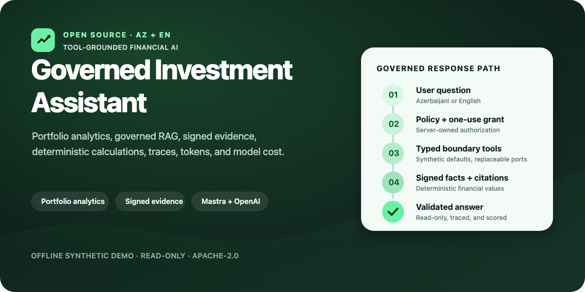

# Governed Investment Assistant




This project started with a practical question: **can a financial AI be useful
without asking people to trust whatever the model says?**

Governed Investment Assistant is an open-source, bilingual AI investment
assistant reference application built with TypeScript, Mastra, and the OpenAI
Responses API. Tools establish portfolio and market facts, deterministic code
owns the calculations, and the language model explains only the evidence it is
allowed to see. If the evidence, policy, or final validation fails, the answer
is blocked.

The demo covers portfolio analytics, stock and ETF research, investment
education, governed retrieval-augmented generation (RAG), read-only order
previews, signed evidence, and privacy-bounded LLM observability. It speaks
Azerbaijani and English, ships with synthetic client data, and uses an offline
synthetic market provider by default. You can replace the fictional product
profile with your own authorized knowledge corpus without rebuilding the trust
architecture. The demo is fictional and is not affiliated with a bank or
broker.

The source tree includes public-repository community, security, CI, licensing,
and customization scaffolding, but the running application remains a reference
pilot. A deployment is pilot-ready only when `GET /api/ready` and the
acceptance gates pass. It is not customer-production ready and it cannot
execute, modify, or cancel an order.

The code is licensed under Apache-2.0. See [LICENSE](LICENSE), [NOTICE](NOTICE),
and [third-party notices](THIRD_PARTY_NOTICES.md).

> [!IMPORTANT]
> This project can explain evidence and neutral decision factors, but it is not
> an investment adviser and does not issue personalized buy, hold, sell, or
> asset-allocation instructions. It is a broad financial assistant, not an
> unrestricted general-purpose chatbot.

## At a glance

The design rule is deliberately simple: tools produce facts, trusted code makes
financial calculations and policy decisions, and the model turns approved
findings into readable language.

| Area | Implementation |
|---|---|
| Agent framework | Mastra agents, workflows, tools, scorers, Studio, and observability |
| Models | OpenAI Responses API with deterministic `gpt-4o` / `gpt-4.1` tier selection |
| Financial capabilities | Portfolio value and allocation, TWR, stock and ETF research, charts, risk, news, fees, education, and read-only order preview |
| Routing | Safety-first deterministic routing plus a schema-constrained semantic planner for otherwise unmatched read-only financial questions |
| Grounding | One-use tool grants, signed tool/fact envelopes, deterministic value insertion, citations, and eight blocking delivery scorers |
| Languages | Azerbaijani (`az-AZ`) and English (`en-US`) |
| Storage | LibSQL for bounded local domains, DuckDB for shared local observability, and a hash-chained JSONL audit outbox |
| Operations | Mastra Studio traces and metrics, Prometheus metrics, token/cost estimates, readiness probes, Docker, Vitest, and Playwright |

Quick links: [Quick start](#quick-start) ·
[Demo prompts](#try-the-demo) ·
[Architecture](#runtime-architecture) ·
[Mastra Studio](#private-mastra-studio) ·
[API](#internal-pilot-api) ·
[Customization guide](docs/OPEN_SOURCE_CUSTOMIZATION.md) ·
[Publishing checklist](docs/PUBLISHING.md) ·
[Production boundary](#production-boundary) ·
[Contributing](CONTRIBUTING.md) ·
[Security](SECURITY.md)

## Repository map

| Path | Purpose |
|---|---|
| [`src/assistant-v3`](src/assistant-v3) | Governed router, semantic planner, policies, Mastra registry, workflows, tools, evidence, renderers, and scorers |
| [`src/services`](src/services) | Offline synthetic defaults plus replaceable market, research, history, news, and knowledge adapters |
| [`public`](public) | Local bilingual demo UI |
| [`knowledge`](knowledge) | Versioned demonstration knowledge sources and manifests |
| [`tests`](tests) | Unit, integration, policy, security, regression, and browser tests |
| [`docs`](docs) | ADRs, operations, production-readiness notes, and customization guidance |

## How a request is handled

Here is the complete request path, from a server-issued session to the response
shown in the UI:

```text
server-issued session → consent and entitlement checks → safety boundaries
→ deterministic routing → bounded follow-up resolution
→ schema-constrained planner for still-unmatched safe turns
→ trusted route compiler → fail-closed policy → workflow-owned boundary tools
→ signed evidence and facts → constrained writer → deterministic rendering
→ eight blocking P0 scorers → durable audit append
→ bounded conversation-context commit → response
```

The installed dependency graph uses `@mastra/core` `1.57.0` and the private
Studio CLI `mastra` `1.23.0`. The V3 architecture registry has four agents,
five online workflows, thirteen boundary tools, and nine scorer entries: eight
blocking customer-response scorers plus one direct-Studio diagnostic scorer.
Studio also materializes each writer output processor as a processor workflow,
so its workflow page shows the five online workflows plus three writer
processor workflows.

### Where the four agents fit

The `financial-task-planner` handles varied wording without becoming an answer
engine. It runs only after deterministic routing returns the generic
`no_deterministic_route` result. The planner can propose one existing
read-only financial capability through a strict schema; trusted code still
extracts symbols, time ranges, currencies, and research facets, validates
subject cardinality and advice class, and constructs the policy-owned route.
The planner has no tools and cannot answer, recommend, authorize, or execute.

Three constrained writers turn already approved evidence into natural language:

- `public-research-writer`
- `portfolio-insight-writer`
- `approved-knowledge-writer`

All three use the OpenAI Responses API with `gpt-4o` by default and `gpt-4.1` only when the deterministic pre-generation policy identifies a comparison, multi-facet evidence composition, multi-citation knowledge answer, or evidence-heavy explanation. Both tiers use temperature `0`, a 256-token output ceiling, `store: false`, and structured claim drafts. Provider errors never promote a request to another model, and the model cannot select its own tier. In the customer workflow path the writers resolve an empty tool set and have no URLs, SQL, account identifiers, arithmetic responsibility, transcript memory, or persistent model memory. Deterministic code inserts exact values and dates after generation. Invalid or unavailable model output uses a deterministic renderer.

The same three registry entries expose a separate loopback-Studio diagnostic view. Only Mastra's reserved Studio request context enables a least-privilege set of public, approved-document, or fixed-synthetic tools. Direct Studio chat deterministically selects one tool for an ordinary factual turn, or exactly two `read-instrument-research` calls for an explicit two-ticker comparison. It verifies every signed envelope, replaces model prose with an exact renderer, and runs a native signed-tool-grounding scorer. Studio Agent chats are saved as local LibSQL threads and recall only the latest ten messages in the current thread; semantic cross-thread recall, generated titles, and working-memory profiles are disabled. This component harness and its transcript memory are never available to customer or workflow writer calls.

Conversational continuity is a separate deterministic control-plane service, not agent memory. After an audited response succeeds, it may retain only a signed, session-bound public symbol and safe intent reference for up to five minutes and three follow-up hops. It never stores prompts, responses, facts, prices, balances, account identifiers, citations, order state, or free-form profile data. An expired, corrupt, wrong-subject, or unavailable context is ignored and the assistant asks for clarification instead of guessing.

### Five deterministic workflows

- `assistant-request-v3`
- `public-research-v3`
- `portfolio-insight-v3`
- `approved-knowledge-v3`
- `order-ticket-handoff-v3`

Workflows own tool calls, branching, policy-bound grants, suspend/resume, writer invocation, rendering, scoring, and audit. Agents do not supervise one another or choose capabilities.

### Thirteen grant-gated boundary tools

- `resolve-instrument`
- `read-market-snapshot`
- `read-price-history`
- `read-instrument-research`
- `read-market-content`
- `convert-currency`
- `analyze-portfolio-allocation`
- `read-portfolio-snapshot`
- `read-portfolio-activity`
- `retrieve-reviewed-investment-education`
- `retrieve-approved-product-knowledge`
- `read-order-eligibility`
- `create-signed-order-handoff`

Every call is bound to one request, workflow, principal, policy decision, tool, and canonical argument hash. Tool output is wrapped in a signed envelope. The official Central Bank of Azerbaijan adapter supplies USD/AZN rates and fails closed when no recent publication is available. Customer-workflow portfolio valuation remains deterministic; the composite `convert-currency` scope exists so the private Studio can safely revalue its synthetic portfolio without trusting earlier prose. Authoritative money uses fixed-point decimal arithmetic.

## Supported pilot capabilities

- Current portfolio value from cash and fully covered priced positions, plus a
  standalone signed cash-balance answer and official-rate AZN conversion.
- Reconciled YTD components and cash-flow-adjusted TWR when the synthetic history supports them.
- Average open-lot cost, sector allocation, and separate one-month price mover and portfolio contribution.
- Bounded recent orders, executions, and executed-buy history from the
  synthetic activity adapter, with account identifiers excluded.
- Quotes, long-range charts, company research, fundamentals, technical indicators, risk, news, sentiment, comparisons, and decision factors for public tickers.
- ETF explanations and instrument-specific risk facts.
- Governed fictional product, disclosure, fee, policy, support, and
  approved-research answers with structured citations.
- Citation-bound bilingual internal-pilot guides for account opening, funding,
  share purchase, and withdrawal. These are read-only local web guides, not
  production broker deep links.
- Fact-bound, GET-only local views for verified portfolio value, cash, recent
  activity, and single-symbol quote answers. The eighth P0 scorer reconstructs
  the action from signed evidence; no identifier is placed in the route.
- A `100 USD AAPL`-style order preview followed by explicit confirmation, a five-minute, one-use, principal-bound handoff reference, and a non-executable internal review page.
- Short follow-ups such as changing the active public symbol or requesting a new safe research facet, using bounded subject-and-intent context rather than model recall.

The handoff is not an order. In this pilot, the signed reference is consumed once to create a sanitized review state for `/orders/preview`. That page disables submission and marks price, fees, balance, disclosures, eligibility, authentication, and final confirmation as pending external-order-system checks. It is a demonstration boundary, not an OMS or broker integration. The assistant has no execution credentials or network path for submitting, changing, or cancelling an order.

The implemented scope is intentionally broad inside the governed finance
domain. Unrelated general-purpose tasks remain outside the active customer
runtime. [ADR-013](docs/adr/ADR-013-dual-lane-general-purpose-assistant.md)
documents a proposed isolated general-purpose lane; it is an architecture
proposal, not an enabled capability.

## Try the demo

These prompts exercise distinct tool-grounded paths. Portfolio and market
values come from bundled synthetic fixtures and are not current observations.

| Prompt | Capability demonstrated |
|---|---|
| `What is my current portfolio value?` | Signed portfolio snapshot and deterministic valuation |
| `Portfelimin bölgüsünü və konsentrasiya riskini təhlil et.` | Azerbaijani allocation and concentration analysis |
| `Imagine a $20,000 portfolio: 40% TSLA, 30% NVDA, 20% MSFT, 10% cash. Analyze it.` | Typed hypothetical-allocation analysis |
| `TWR nədir?` | Reviewed bilingual investment education |
| `How do Demo Invest fees work?` | Governed product-knowledge retrieval with citations |
| `Show a one-month price chart for NVDA.` | Signed price history and chart-ready facts |
| `Preview a 100 USD AAPL purchase. Do not place an order.` | Read-only intent parsing and signed preview handoff |

After each request, inspect Mastra Studio for the workflow, boundary-tool spans,
grounding score, token usage, and estimated model cost.

## Data and storage boundary

- Client identity, account, holdings, lots, transactions, cash flows, income, fees, and corporate actions are synthetic.
- The default market, history, and limited company-profile observations are
  project-authored synthetic fixtures generated entirely offline. They are not
  current market facts. An external development provider is an explicit opt-in
  and requires the operator to validate access and usage rights.
- Product knowledge retrieval uses immutable local source snapshots, exact
  locale/jurisdiction/approval/effective-date filters, a versioned LibSQL
  vector index, lexical reranking, and citation validation.
- Customer workflow snapshots use a process-local Mastra store: ordinary request, research, portfolio, and knowledge workflows disable snapshot persistence entirely, while the order-confirmation workflow retains only the volatile snapshot required by Mastra suspend/resume. Prompts, bearer tokens, and intermediate facts are therefore not written to the file-backed LibSQL stores. Other non-observability domains use physically separate application and private-Studio LibSQL files. In the default local shared-observability mode, Studio is the sole physical owner of `.mastra-observability-shared.duckdb`; the application does not open that embedded database and instead sends privacy-projected traces, metrics, logs, scores, and feedback through an authenticated `127.0.0.1` bridge. This avoids concurrent DuckDB writers while making both application and Studio records visible in Studio, distinguished by their bounded service names. Before application export, V3 drops prompts, model output, request context, identifiers, and raw error details; only bounded reviewed operational fields are retained. Studio-originated developer records use the separate loopback-only privacy profile described below.
- Development database files created by an earlier snapshot-persisting build are not deleted automatically. Before sharing or retaining an upgraded workspace, stop the processes and explicitly archive or remove those historical files under the applicable local-data policy.
- The private Studio Editor uses code-source, reviewable per-agent JSON files and permits only tool-description changes. Instructions, tool membership, model settings, policy, workflows, and scorers remain code-owned. The customer application does not mount Editor overrides.
- The audit outbox is an append-only, SHA-256 hash-chained JSONL file and each append is flushed before a financial response is delivered.
- Session authority, bounded conversation context, and suspended order-handoff state remain process-local in this pilot. Restarting the app invalidates them. The context store is capped at 10,000 entries, has a five-minute TTL and three-hop limit, and is not a transcript store.
- Operational telemetry is redacted and bounded. Raw customer reconstruction data must not be exported through normal logs, traces, or metric labels.

## Quick start

Requirements: Node.js 22.13 or newer. Model-backed generation also requires an
OpenAI API key with access to `gpt-4o` and `gpt-4.1`.

```bash
npm ci
umask 077 && cp .env.example .env.local
# Edit .env.local and set OPENAI_API_KEY.
npm run knowledge:ingest
```

> [!NOTE]
> `npm test` does **not** use your OpenAI API key. Vitest installs a fake key
> before application modules load and rejects every non-loopback network
> request. Starting the application or Mastra Studio is different: model-backed
> conversations can call OpenAI and may incur provider charges.

Shared local observability makes Studio the DuckDB owner, so start Studio before
the application:

```bash
# Terminal 1
npm run studio

# Terminal 2, after Studio is listening on 127.0.0.1:4111
npm start
```

Open the [demo application](http://localhost:3000) and
[Mastra Studio](http://127.0.0.1:4111). Confirm the two local processes before
testing a conversation:

```bash
curl --fail http://127.0.0.1:3000/api/health
curl --fail http://127.0.0.1:3000/api/ready
```

After sending a demo message, use Studio's **Traces** view to inspect the
workflow and tool spans, and **Metrics** to inspect token and estimated model
cost data. The application also exposes bounded JSON metrics at
`http://127.0.0.1:3000/api/metrics` and Prometheus text at
`http://127.0.0.1:3000/metrics`.

Relevant local defaults:

```dotenv
OPENAI_MODEL=gpt-4o
OPENAI_ESCALATION_MODEL=gpt-4.1
ASSISTANT_PRODUCT_PROFILE=demo-invest
ASSISTANT_DEMO_MARKET_PROVIDER=synthetic-offline
ASSISTANT_PUBLIC_BRAND_NAME=
ASSISTANT_PUBLIC_BRAND_MARK=
ASSISTANT_PUBLIC_PRODUCT_NAME=
ASSISTANT_METRICS_PREFIX=investment_assistant
MASTRA_STORAGE_URL=file:./.mastra-storage-private-v2.db
MASTRA_STUDIO_STORAGE_URL=file:./.mastra-storage-studio-private-v3.db
MASTRA_OBSERVABILITY_SHARED=true
MASTRA_OBSERVABILITY_PATH=.mastra-observability-shared.duckdb
MASTRA_STUDIO_OBSERVABILITY_PATH=.mastra-observability-shared.duckdb
MASTRA_STUDIO_EDITOR_CODE_PATH=src/assistant-v3/editor-overrides
ASSISTANT_AUDIT_OUTBOX_PATH=.assistant-v3-audit.jsonl
KNOWLEDGE_VECTOR_URL=file:./.knowledge-vector.db
KNOWLEDGE_INDEX_NAME=demo_invest_knowledge_2026_07_29_v1
KNOWLEDGE_INDEX_GENERATION=demo-invest-2026-07-29-v1
KNOWLEDGE_APPROVAL_MODE=official-publication
ASSISTANT_V3_ENABLED=true
ASSISTANT_V3_CONVERSATION_MEMORY_ENABLED=true
ASSISTANT_V3_CONVERSATION_MEMORY_TTL_MS=300000
ASSISTANT_V3_CONVERSATION_MEMORY_MAX_ENTRIES=10000
ASSISTANT_V3_CONVERSATION_MEMORY_MAX_HOPS=3
```

The runtime rejects any primary model other than `gpt-4o` and any escalation model other than `gpt-4.1`. Selection is deterministic and happens before generation; there is no provider-error model fallback. Mastra Studio remains loopback-only; the OpenAI credential is loaded server-side from the process environment, `.env.local`, or `.env`, in that precedence order.

For a non-billable local writer-contract check, keep the application and Studio
stopped and run an already-installed Ollama model over loopback:

```bash
env -u OPENAI_API_KEY npm run eval:ollama-writer
# Optional, if it is already installed:
env -u OPENAI_API_KEY OLLAMA_TEST_MODEL=qwen3.5:4b npm run eval:ollama-writer
```

The evaluator is fixed to `http://127.0.0.1:11434`, refuses models outside its
small allowlist, checks the local model inventory before generation, and never
pulls a model. It records only pass/fail reason codes for fixed synthetic
English and Azerbaijani quote/comparison cases. A local pass is development
evidence only: it neither changes the production model policy nor substitutes
for an approved OpenAI smoke test. The latest retained local result is recorded
in [docs/local-ollama-writer-evaluation-2026-07-25.md](docs/local-ollama-writer-evaluation-2026-07-25.md).

## Internal-pilot API

V3 does not accept a customer-supplied client ID, account ID, policy filter, tool argument, or arbitrary conversation ID.

| Endpoint | Purpose |
|---|---|
| `POST /v1/assistant/sessions` | Create a server-owned assistant session for `az-AZ` or `en-US` |
| `POST /v1/assistant/messages` | Send a message with the session bearer token |
| `POST /v1/assistant/order-handoffs/{intentId}/confirm` | Explicitly confirm a suspended preview and receive a signed handoff |
| `POST /v1/assistant/order-handoffs/open` | Consume that signed handoff once and return a sanitized, non-executable internal review state |
| `POST /api/chat` | Temporary one-message compatibility adapter; creates its own V3 session |

The first endpoint returns the bearer token and server-owned session and conversation identifiers. The message, confirmation, and open endpoints require `Authorization: Bearer <sessionToken>`. Only `{ "confirmed": true }` can resume an order preview. The open call verifies the compact signature, principal and session binding, expiry, purpose, and signed payload before consuming it; its response cannot submit an order.

Operational endpoints:

| Endpoint | Purpose |
|---|---|
| `GET /api/health` | Minimal unauthenticated process liveness; performs no dependency probes |
| `GET /api/ready` | Minimal readiness for the selected release target, with generic error codes and single-flight short-TTL dependency probes |
| `GET /api/internal/diagnostics/readiness` | Internal-pilot-only dependency, topology, and blocker diagnostics; requires the configured bearer token |
| `GET /api/mastra/capabilities` | Internal-pilot-only exact V3 registry manifest; requires the configured bearer token |
| `GET /api/metrics` | Bounded JSON metrics |
| `GET /metrics` | Prometheus-format metrics |
| `GET /api/bootstrap` | Pilot UI bootstrap and V3 capability flags |

Successful constrained-writer generations increment
`investment_assistant_model_tokens_total` on both application metric endpoints. Its
labels are restricted to the reviewed `provider`, `model`, `workflow`, `agent`,
and `kind` domains. Base model usage is `kind="input"` plus `kind="output"`;
`cached_input` and `reasoning_output` are optional subsets and must not be
added again when calculating a total. Prompts, request identifiers, and raw
provider metadata are never metric labels.

The same generations increment
`investment_assistant_model_estimated_cost_usd_total` with bounded `provider`, `model`,
and `kind="input"|"output"` labels. This process-local counter mirrors the
estimated USD component costs attached to Mastra's two native total-token
metrics; sum its input and output series for the estimated generation cost.
It is not a provider invoice or billed-cost ledger.

`ASSISTANT_INTERNAL_DIAGNOSTICS_TOKEN` is optional and must be a URL-safe
32–512 character secret when configured. If it is unset, both detailed
diagnostic routes behave as absent and return the same safe `404` response even
when a caller supplies a bearer token. A malformed configured value fails
startup.

Legacy read-only dashboard endpoints remain during UI migration, but `/v1/assistant/*` is the authoritative assistant contract.

## Private Mastra Studio

Start the private Studio separately:

```bash
npm run studio
```

Open [http://127.0.0.1:4111](http://127.0.0.1:4111). The command binds Studio to loopback, refuses configured customer exposure, and registers the exact V3 topology. Its Tool pages and direct Agent chats use one-use grants with live development-only public evidence, a fixed synthetic portfolio principal, approved documents in process memory, and synthetic order eligibility. Customer data and signed order handoff are disabled. An ordinary direct factual chat must show one tool call and a `v3.agent.direct-tool-grounding` score of `1`; an explicit two-ticker comparison must show exactly two signed `read-instrument-research` calls and the same passing score. The eight customer delivery scorers are visible under Scorers but remain authoritative only inside the application workflow, where the trusted route, policy, fact graph, citations, exact tool arguments, and fact-bound navigation authorization exist.

Studio exposes persistent Mastra Observability for both its direct runs and the
application's privacy-projected signals. Studio is the only process that opens
`.mastra-observability-shared.duckdb`; the application publishes through the
authenticated loopback bridge instead of becoming a second embedded-DuckDB
writer. Studio displays both sources and distinguishes them by service name:
`governed-investment-assistant-v3` for the application and
`governed-investment-assistant-v3-studio` for Studio. Studio-originated direct runs keep
complete input/output and log-message text for local debugging, while
application-originated records remain redacted at their export boundary. Use
only public, approved, or synthetic content in Studio because this shared local
developer telemetry and transcript storage is not approved for customer data.
Agent conversations still persist separately in Studio's local LibSQL store by
thread. The customer application never loads Studio Editor drafts or transcript
memory.

Model-generation spans retain only bounded numeric usage plus the locked
provider/model identity, allowing Mastra to publish its native
`mastra_model_total_input_tokens`, `mastra_model_total_output_tokens`, and
approved text/cache/reasoning/audio/image detail metrics. Each native token
metric carries Mastra's locally estimated `estimatedCost` and `costUnit` when
its bundled pricing registry recognizes the provider and model. To calculate
generation cost without double-counting, sum the estimated cost on only
`mastra_model_total_input_tokens` and
`mastra_model_total_output_tokens`; detail rows repeat their category costs.
This is an estimate, not provider-reported billed cost. Studio shows these
metrics for both service names in the shared DuckDB. Application requests also
remain represented in the bounded HTTP metrics above.

For troubleshooting startup order, shared storage, missing traces, model
identity, or metric interpretation, see the
[private Studio runbook](docs/studio-runbook.md).

Studio is an administrator/developer surface, never part of the customer artifact. `npm run build` excludes the Studio entry point, Studio-only modules, and Editor override files; the container prunes the Studio CLI, Editor, and Studio-memory packages because they are development dependencies. A future shared admin deployment requires a separate artifact and threat model, SSO/MFA, network restriction, scrubbed read-only data, and separate approval.

## Runtime architecture

```mermaid
flowchart LR
    UI["Pilot UI"] --> API["V1 session API"]
    API --> AUTH["Trusted context, consent, entitlements"]
    AUTH --> ROUTE["Safety-first deterministic AZ/EN route"]
    ROUTE --> MEMORY["Signed bounded follow-up resolution"]
    MEMORY -->|"still unmatched safe financial turn"| PLAN["Tool-less semantic planner"]
    PLAN --> COMPILE["Trusted route compiler"]
    COMPILE --> POLICY
    MEMORY --> POLICY["Fail-closed policy"]
    POLICY --> WF["Five Mastra workflows"]
    WF --> GRANT["One-use capability grants"]
    GRANT --> TOOLS["Thirteen boundary tools"]
    TOOLS --> EVIDENCE["Signed tool and fact envelopes"]
    EVIDENCE --> SELECT["Deterministic model-tier policy"]
    SELECT --> WRITER["One of three constrained writers<br/>gpt-4o or gpt-4.1"]
    WRITER --> RENDER["Deterministic renderer"]
    RENDER --> GATE["Eight blocking P0 scorers"]
    GATE --> AUDIT["fsync hash-chain audit append"]
    AUDIT --> MEMORY
    AUDIT --> UI
    WF -->|"preview"| SUSPEND["Mastra suspend/resume"]
    SUSPEND -->|"explicit confirm"| HANDOFF["Signed one-use handoff"]
```



Any P0 scorer failure or error blocks delivery and disables the affected capability until restart. `not_applicable` is never counted as a pass.

## Commands

```bash
npm run dev
npm run studio
npm start
npm run knowledge:ingest
npm run typecheck
npm test
npm run check
npm run build
npm run security:scan
npm run security:audit
npm run license:verify
npm run docs:verify
npm run open-source:verify
npm run release:verify
```

## Build, container, and CI

`npm run build` creates the application-only `dist` tree. It does not compile
the private Studio entry point or copy Editor drafts. The multi-stage
`Dockerfile` uses an immutable Node base-image digest, runs as a non-root user,
and copies only the pruned production dependencies, application `dist`, and
static pilot UI. Its liveness check calls `/api/health`; selected-target
readiness remains a separate `/api/ready` decision. A production-mode container
requires an externally supplied `ASSISTANT_SIGNING_KEY` of at least 32
characters and intentionally reports a generic fail-closed `503` from
`/api/ready` until approved production integrations replace every blocker.

For a loopback internal pilot, `compose.internal-pilot.yml` deliberately selects `ASSISTANT_RELEASE_TARGET=internal-pilot`, binds port 3000 to `127.0.0.1`, mounts a local data volume, uses a read-only root filesystem, drops Linux capabilities, and enables `no-new-privileges`. It is an application-only topology with `MASTRA_OBSERVABILITY_SHARED=false`, so it writes to its configured application observability store without requiring or exposing Studio. It is not a customer-production deployment definition. Export `OPENAI_API_KEY` from an approved local secret source before starting it; optionally export the bounded diagnostics token from the same class of secret source when operator diagnostics are required. Compose intentionally does not bulk-inject `.env.local`.

```bash
docker compose -f compose.internal-pilot.yml up --build
```

GitHub Actions run the release verifier, browser/accessibility tests, CodeQL,
dependency review, and history-aware secret scanning. CI uploads a CycloneDX
dependency SBOM and a no-push OCI archive with an attached SPDX SBOM,
maximum-mode provenance, extracted in-toto statements, build metadata, image
digest, CI context, and checksums. These retained artifacts are reproducibility
and review evidence, not a signed production image or customer-production
acceptance. Performance/load/SLO, penetration, disaster-recovery, and governed
live-provider smoke tests remain separate release gates.

## Production boundary

`GET /api/ready` reports only the aggregate readiness of the selected release
target and never exposes model, provider, index, topology, or blocker details.
For an internal pilot, operators may configure
`ASSISTANT_INTERNAL_DIAGNOSTICS_TOKEN` and use the bearer-protected
`/api/internal/diagnostics/readiness` route to inspect both readiness decisions.
Customer production remains blocked while identity is mock, ledger or market
data is synthetic, a licensed production feed is absent, signing is
development-grade, state is local or process-bound, legacy routes are
unauthenticated, model governance is unresolved, or Studio code or services
enter the customer artifact. An explicitly selected development feed is never
a customer-production fallback.

Production also requires downstream OIDC and tenant/account entitlements,
authoritative signed ledger adapters, licensed market data, managed
purpose-bound asymmetric signing, controlled locale-specific knowledge
approvals, remote HA storage, a transactional audit outbox plus independently
retained tamper-evident archive, and durable distributed
session/grant/revocation/handoff state. The real OMS/order screen must
independently revalidate every material check. Gateway/WAF controls, DLP and
model-provider governance, SSO/MFA for any separately deployed admin Studio,
performance evidence, penetration and recovery exercises, incident/SLO
operations, and applicable Legal/Compliance/Risk/Security/regulatory approval
remain required.

See the [customization guide](./docs/OPEN_SOURCE_CUSTOMIZATION.md),
[publishing checklist](./docs/PUBLISHING.md),
[ARCHITECTURE.md](./ARCHITECTURE.md),
[production readiness](./docs/production-readiness.md),
[ADR-010](./docs/adr/ADR-010-mastra-for-mvp.md),
[ADR-011](./docs/adr/ADR-011-governed-rag.md),
[ADR-012](./docs/adr/ADR-012-runtime-model-and-memory.md),
[ADR-013](./docs/adr/ADR-013-dual-lane-general-purpose-assistant.md),
the [knowledge runbook](./docs/knowledge-runbook.md), and the
[private Studio runbook](./docs/studio-runbook.md).
